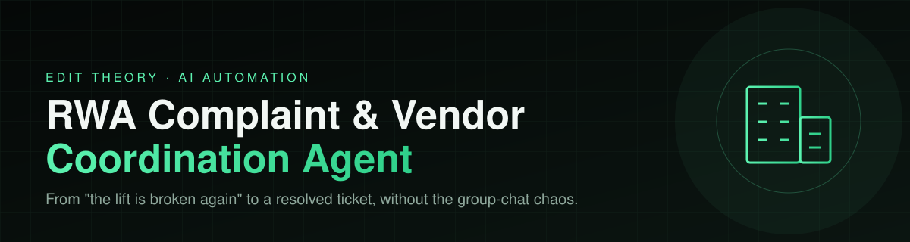
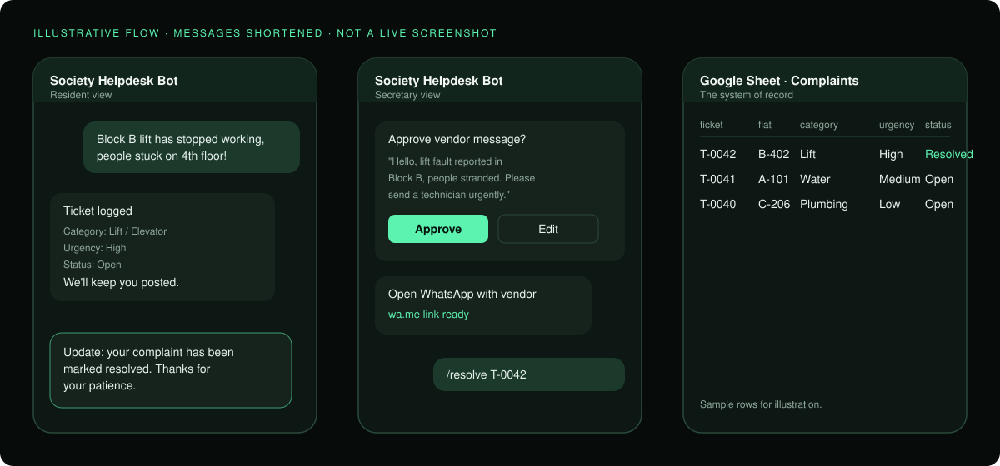
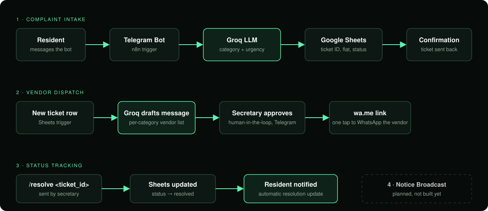

 

**An AI agent that runs the complaint desk of an Indian apartment society, with the secretary approving everything that leaves the building.**

[The problem](#the-problem) · [How it works](#how-it-works) · [Workflows](#the-four-workflows) · [Status](#honest-status) · [Engineering notes](#engineering-notes)

---

## The problem

Every residential society (RWA) in India runs on the same loop. A resident complains in a 300-person WhatsApp group. The message scrolls away. The secretary phones a plumber from memory. Nobody knows if it got fixed until the same resident complains again, louder.

There is no ticket, no record, no owner, and no closure.

## The fix

Residents message one bot. The agent logs, classifies, drafts and tracks. The secretary stays in control of anything that goes to a vendor or to the whole society.

| Before | After |
|---|---|
| Complaint buried in a group chat | Logged as a ticket with ID, flat, category and urgency |
| Secretary hunts for the right vendor's number | Vendor message drafted from a per-category vendor list |
| Vendor contacted with no oversight | Secretary approves in Telegram first |
| Resident never hears back | Resident is notified automatically on resolution |
| "Did everyone see the notice?" | Acknowledgements logged per resident |

## How it works

Four workflows on one n8n canvas, one Google Sheet as the system of record.

## The four workflows

Built and tested one at a time.

### 1. Complaint Intake
A resident messages the bot ("water leak in B-402"). Groq classifies category (plumbing, electrical, security, common-area, other) and urgency (low, medium, high). The ticket is logged to Google Sheets with a ticket ID, flat number, status and timestamp. The resident gets the ticket ID back.

### 2. Vendor Dispatch
A new ticket triggers a lookup in the society's vendor list for that category. Groq drafts a short dispatch message. The secretary gets it on Telegram with Approve and Disapprove buttons. On approval she gets a pre-filled WhatsApp link to send to the vendor, and the ticket becomes `dispatched`. If no vendor exists for the category, she is told to handle it manually.

### 3. Status Tracking
The secretary sends `/resolve <ticket_id>`. The sheet updates with `resolved` and a timestamp, and the resident is notified automatically. Only the secretary's chat can resolve tickets.

### 4. Notice Broadcast
The secretary sends `/notice <text>`. Groq formats it without adding facts, she approves a preview, and it is sent to every resident on file. Residents reply `/ack`, and each acknowledgement is logged to a sheet, so she doesn't scroll a group chat to see who has seen it.

## Design principles

- **Human in the loop.** Nothing reaches a vendor or the residents without the secretary's approval. The AI drafts, a person decides.
- **One source of truth.** A single Google Sheet the committee can open and read.
- **Free-tier friendly.** Groq, Sheets, Telegram and self-hosted n8n. No per-seat software bill.
- **Portable per society.** Sheet IDs, society name and categories live in one Config node. A new society means changing that node and the sheets, not the workflow logic.
- **No invented content.** The notice formatter is told to keep every fact exactly as given and add nothing.

## Honest status

A working build, not a production deployment.

| Piece | State |
|---|---|
| All four workflows | Built and tested end to end on test data (test residents, test vendors, my own Telegram account) |
| Real-society pilot | Not done yet |
| Vendor messaging | Pre-filled WhatsApp link the secretary taps. WhatsApp Cloud API is not connected |
| Hosting | Local Docker with an ngrok tunnel, so it is offline when that machine is off |
| Usage numbers | None to report, so none are claimed |

## Stack

| Layer | Tool |
|---|---|
| Orchestration | n8n (self-hosted, local Docker) |
| LLM | Groq, `llama-3.3-70b-versatile` |
| Messaging | Telegram Bot API |
| Data | Google Sheets |
| Tunnel | ngrok |

## Sheet structure

- `Complaints`: ticket_id, flat_number, category, urgency, resident_message, status, timestamp, chat_id, resolved_at
- `Residents`: chat_id, flat_number, resident_name
- `Vendors`: category, vendor_name, phone
- `Notices`: notice_id, text, sent_at
- `Acks`: notice_id, chat_id, flat_number, resident_name, acked_at

## Engineering notes

Real problems hit while building this.

- **One Telegram trigger per bot.** A bot has one webhook, so `/resolve`, `/notice`, `/ack` and normal complaints all enter through the same trigger and are split with IF nodes. A second trigger would conflict.
- **Fixed vs Expression mode.** A value typed with a leading `=` in a Fixed field is stored as literal text. The resident lookup silently matched nothing until this was found.
- **After a Sheets node, `$json` is the sheet row.** The original message is gone. Reference earlier nodes by name instead, for example `$('Create Ticket').first().json.ticket_id`.
- **Always Output Data on lookups.** A Get Row(s) that finds nothing stops the workflow. Turning this on lets the "not found" and "no vendor" branches run.
- **Strip Groq's markdown fences before `JSON.parse()`.** The classifier sometimes wraps JSON in code fences despite being told not to.
- **Test and production webhooks conflict for Telegram.** n8n can't listen for a test event while the workflow is active. Deactivate to test.
- **Google Sheets "By List" needs the Drive API.** Without it the dropdown is disabled and the node returns "resource not found".
- **Telegram can't message people first.** Residents must press Start on the bot before they can receive broadcasts.

## Known limitations

- Vendor messages need a manual tap on a WhatsApp link until the WhatsApp Cloud API is connected.
- Residents are added to the `Residents` sheet by hand. There is no self-registration, and no handling yet for an unregistered resident.
- Duplicate `/ack` messages create duplicate rows. Count unique `chat_id` per `notice_id`.

## Next

- [ ] Pilot with a real society secretary
- [ ] WhatsApp Cloud API for vendor messaging
- [ ] Resident self-registration
- [ ] Move off local Docker to always-on hosting

---

Built by **Samhita** · [Edit Theory](https://github.com/Samhita1008)

